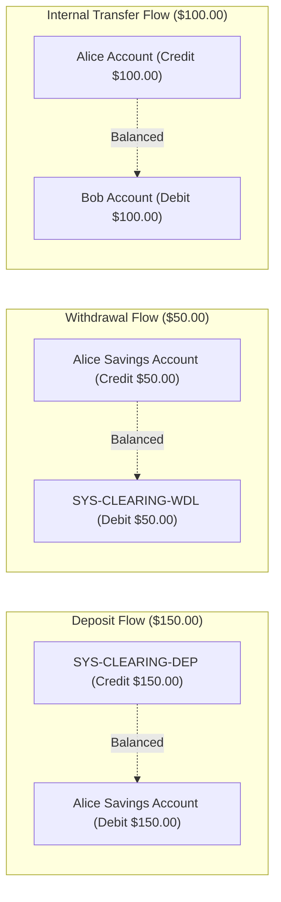
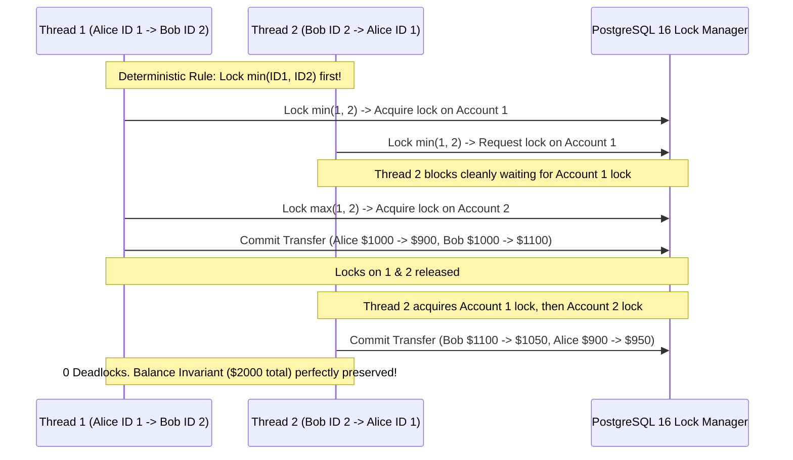
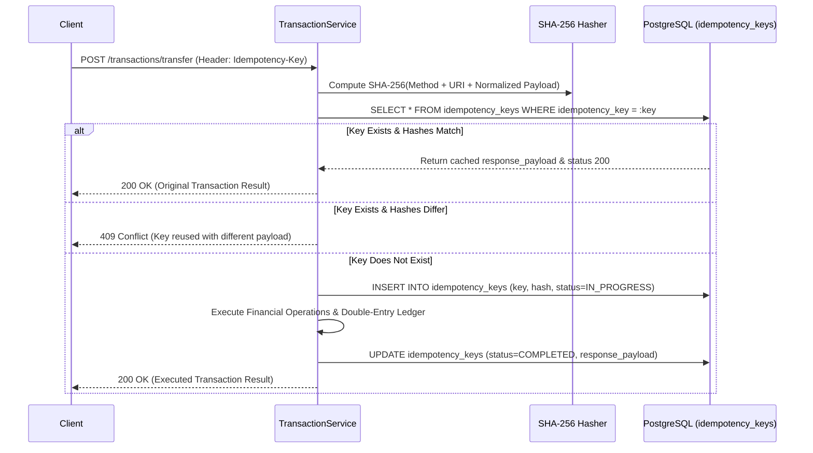

# LEDGERLINE – Architecture & System Design Documentation

**Project:** LEDGERLINE – Money Movement With a Ledger You Can Prove  
**Assessment:** Snovasys 2026 Fresher Hiring Assessment  
**Author:** Senior Software Architect, Financial Systems Engineer & Security Engineer  
**Version:** 1.0.0  

---

## 1. System Overview

LEDGERLINE is an institutional-grade financial transaction management system engineered to guarantee **absolute financial integrity**, **mathematical balance consistency**, **zero double-spending**, **stateless authorization**, and **immutable auditability**.

The system adopts a **Clean Layered Architecture** with strict boundaries between REST interface contracts, domain service logic, database persistence, and security enforcement.

```mermaid
flowchart TD
    subgraph Client ["Client Layer"]
        UI["React + Vite Single Page Application"]
        ExtAPI["REST API Clients (cURL, Postman)"]
    end

    subgraph SecurityLayer ["Security & Boundary Layer"]
        Filter["JwtAuthenticationFilter"]
        Blacklist["TokenBlacklistService (SHA-256 Persistent Store)"]
        Validator["AccountOwnershipValidator (IDOR Defense)"]
    end

    subgraph ControllerLayer ["REST Controller Layer (Thin)"]
        AuthCtrl["AuthController"]
        AccCtrl["AccountController"]
        TxCtrl["TransactionController"]
        AuditCtrl["AuditController"]
        AdminCtrl["AdminController"]
        HealthCtrl["HealthController"]
    end

    subgraph ServiceLayer ["Core Domain & Financial Engine"]
        TxSvc["TransactionService (@Transactional)"]
        AccSvc["AccountService"]
        AuthSvc["AuthService"]
        AuditSvc["AuditService"]
        IdemEng["Idempotency Engine (SHA-256 Hashing)"]
        LedgerEng["DoubleEntryLedgerEngine (Debits == Credits)"]
    end

    subgraph PersistenceLayer ["PostgreSQL 16 Persistence Layer"]
        PessLock["Pessimistic Row Locking (SELECT ... FOR UPDATE)"]
        DeterministicLock["Deterministic Lock Ordering (min(id1, id2) -> max(id1, id2))"]
        CheckConstraints["CHECK Constraints (chk_balance >= 0)"]
        Flyway["Flyway Versioned Migrations (V1..V5)"]
    end

    Client --> SecurityLayer
    SecurityLayer --> ControllerLayer
    ControllerLayer --> ServiceLayer
    ServiceLayer --> PersistenceLayer
```



---

## 2. Clean Layered Architecture

The backend codebase is organized under `com.ledgerline` in compliance with institutional clean code standards:

| Package | Responsibility | Invariants & Constraints |
| :--- | :--- | :--- |
| `config` | Spring Security, Web MVC, CORS, PasswordEncoder, ObjectMapper. | No business logic. Standardized security filter chains. |
| `controller` | Thin REST controllers accepting DTOs and validating with `@Valid`. | No direct entity exposure. No database operations. |
| `dto` | Request and response representations with Bean Validation annotations. | Pure data carriers; no database annotations. |
| `entity` | JPA domain models mapped to PostgreSQL tables. | All financial fields use `BigDecimal`. Table constraints configured. |
| `enums` | Strongly-typed status and role representations (`Role`, `TransactionType`, `TransactionStatus`, `EntryType`, `AccountType`). | Closed set of valid states. |
| `exception` | Centralized exception hierarchy and `@RestControllerAdvice`. | Standard RFC-7807 Problem Detail response payloads. |
| `repository` | Spring Data JPA repositories with row-level locking queries. | Pure SQL/JPQL access. Hydration happens inside transaction. |
| `security` | JJWT 0.12.6, token validation, user details service, IDOR validators. | Independent of financial business rules. |
| `service` | Transactional business orchestrators (`@Transactional`). | Enforces idempotency, lock ordering, balance mutations. |
| `ledger` | `DoubleEntryLedgerEngine` proving mathematical balance. | $\sum \text{Debits} == \sum \text{Credits} == \text{Amount}$. |
| `audit` | Append-only immutable security and transaction event logger. | Entity marked `@Immutable`; deletion strictly prohibited. |
| `util` | Numeric formatting, canonical JSON hashing, reference generators. | Pure, deterministic utility functions. |

---

## 3. Financial Integrity & Double-Entry Accounting

### 3.1 Double-Entry Balance Equation

Every financial movement in LEDGERLINE creates a persistent `Transaction` record accompanied by **at least two balanced `LedgerEntry` records**:

$$\sum \text{Debits} \equiv \sum \text{Credits} \equiv \text{Transaction Amount}$$

- **DEBIT Entry:** Increases asset accounts (or debits clearing accounts).
- **CREDIT Entry:** Decreases asset accounts (or credits clearing accounts).
- If total debits do not match total credits to the exact cent, the `DoubleEntryLedgerEngine` throws `UnbalancedLedgerException` and the entire Spring `@Transactional` transaction rolls back.



### 3.2 System Clearing Accounts

To preserve double-entry integrity for external capital injections and extractions (deposits and withdrawals) without integrating real banking payment gateways, LEDGERLINE maintains dedicated institutional clearing accounts seeded via Flyway:

1. **`SYS-CLEARING-DEP` (`SYSTEM_CLEARING`):**
   - Counterparty for customer deposits.
   - When a customer deposits funds, the customer account is debited (increased), and `SYS-CLEARING-DEP` is credited.
2. **`SYS-CLEARING-WDL` (`SYSTEM_CLEARING`):**
   - Counterparty for customer withdrawals.
   - When a customer withdraws funds, the customer account is credited (decreased), and `SYS-CLEARING-WDL` is debited.

### 3.3 Strict `BigDecimal` Currency Handling

- Financial calculations **never** use floating-point types (`float` or `double`).
- All amounts are instantiated with `BigDecimal` with scale 2 and `RoundingMode.HALF_EVEN` (Banker's Rounding):
  ```java
  public static BigDecimal scaleMoney(BigDecimal amount) {
      if (amount == null) return BigDecimal.ZERO.setScale(SCALE, RoundingMode.HALF_EVEN);
      return amount.setScale(SCALE, RoundingMode.HALF_EVEN);
  }
  ```
- Any transaction with amount $\le 0.00$ is rejected immediately with `InvalidAmountException` (400 Bad Request).
- Negative account balances are barred at two distinct enforcement tiers:
  1. **Domain Engine Check:** `DoubleEntryLedgerEngine.validateSufficientBalance()`.
  2. **Database Engine Constraint:** PostgreSQL check constraint `chk_account_balance_non_negative (balance >= 0)`.

---

## 4. Concurrency & Deadlock Prevention Architecture

### 4.1 Race Condition Defense: Pessimistic Row Locking

When multiple concurrent requests attempt to withdraw or transfer funds from the same account, a standard read-modify-write cycle would allow overdrafts (double-spending).

LEDGERLINE enforces pessimistic write locking at the PostgreSQL engine level:

```java
@Lock(LockModeType.PESSIMISTIC_WRITE)
@Query("SELECT a FROM Account a WHERE a.id = :id")
Optional<Account> findByIdWithLock(@Param("id") Long id);
```

This translates to PostgreSQL `SELECT ... FOR UPDATE`, blocking concurrent transactions until the current transaction commits or rolls back.

### 4.2 Eliminating Circular Wait Deadlocks: Deterministic Lock Ordering

In bidirectional transfers (Alice transfers to Bob while Bob simultaneously transfers to Alice), concurrent transactions acquiring locks in arbitrary order create classic circular-wait deadlocks ($T_1$ holds Alice, waits for Bob; $T_2$ holds Bob, waits for Alice).

LEDGERLINE mathematically eliminates deadlocks through **Deterministic Lock Ordering**:

```java
// Always acquire locks in ascending Primary Key ID order
Long minId = Math.min(sourceId, destId);
Long maxId = Math.max(sourceId, destId);

Account firstLocked = accountRepository.findByIdWithLock(minId).orElseThrow(...);
Account secondLocked = accountRepository.findByIdWithLock(maxId).orElseThrow(...);

Account sourceAccount = sourceId.equals(minId) ? firstLocked : secondLocked;
Account destAccount = destId.equals(minId) ? firstLocked : secondLocked;
```

Because every thread acquires locks in strictly increasing order, circular waits are impossible:



### 4.3 Hibernate L1 Cache Hydration Protection

To ensure the locked entity reflects the true, current state on disk rather than a stale entity cached earlier in the Hibernate session, LEDGERLINE resolves account IDs using a lightweight primitive scalar query:

```java
@Query("SELECT a.id FROM Account a WHERE a.accountNumber = :accountNumber")
Optional<Long> findIdByAccountNumber(@Param("accountNumber") String accountNumber);
```

By querying only the primitive `Long` ID before locking, the `Account` entity is hydrated from the database for the first time **strictly under the `PESSIMISTIC_WRITE` lock**.

---

## 5. Idempotency Protection Engine

To protect against duplicate transaction execution caused by network retries, connection timeouts, or accidental multi-clicks, all money-movement endpoints require an `Idempotency-Key` header (UUIDv4).



### Key Invariants:
1. **Uniqueness:** Guaranteed by PostgreSQL unique index `uk_idempotency_key`.
2. **Atomic Processing:** Idempotency key creation and financial execution occur inside the same `@Transactional` boundary.
3. **Payload Verification:** Canonical JSON payload hashing ensures identical payload verification across variations in whitespace.
4. **Conflict Defense:** Attempting to reuse an idempotency key with different parameters returns `409 Conflict`.

---

## 6. Authentication & Insecure Direct Object Reference (IDOR) Defense

### 6.1 Authentication Architecture
- **Stateless JWT:** Signed using HMAC-SHA256 (`JJWT 0.12.6`). Tokens contain `userId`, `username`, and `role`.
- **Instant Token Revocation:** Upon logout, the token's SHA-256 digest is persisted to `token_blacklist`. Every incoming request is checked against this table by `JwtAuthenticationFilter`.
- **Password Hashing:** Passwords hashed with BCrypt. Plaintext passwords and hashes are never returned in JSON or logs.

### 6.2 Three-Tier Role-Based Access Control (RBAC)
- **`ADMIN`:** User management, account inspection, system health, platform overview.
- **`CUSTOMER`:** Self-service operations strictly on accounts owned by the user.
- **`AUDITOR`:** Read-only access to transactions, double-entry journals, and audit trails. Prohibited from mutating accounts or transferring money.

### 6.3 Multi-Layer IDOR Defense (`AccountOwnershipValidator`)
The backend never trusts customer IDs or account numbers supplied in the request body. All operations undergo domain validation:

```java
public void validateAccountWriteAccess(Account account) {
    if (securityContextHelper.isAuditor()) {
        throw new AccessDeniedException("Auditors are restricted to read-only access");
    }
    User currentUser = securityContextHelper.getCurrentUser();
    if (!currentUser.getId().equals(account.getUser().getId()) && !securityContextHelper.isAdmin()) {
        throw new AccessDeniedException("You do not have permission to execute operations on this account");
    }
}
```

---

## 7. Append-Only Audit Trail

To meet regulatory and compliance requirements:
1. **Entity Immutability:** `AuditLog` is marked `@org.hibernate.annotations.Immutable`. All column definitions specify `updatable = false`.
2. **Repository Hardening:** `AuditLogRepository` overrides all deletion methods (`delete`, `deleteAll`, `deleteById`) to throw `UnsupportedOperationException`.
3. **Transaction Propagation Strategy:**
   - Financial operations log audit events inside the primary transaction boundary.
   - Authentication and security failure events log via `Propagation.REQUIRES_NEW`, ensuring audit records commit even when outer transactions abort due to security exceptions.
4. **Auditor Exclusivity:** Audit query APIs (`GET /api/v1/audit/**`) are strictly restricted to users holding the `AUDITOR` or `ADMIN` roles.
