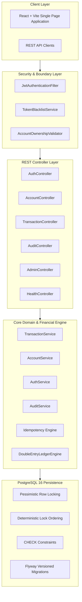
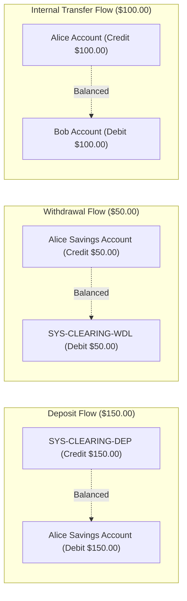
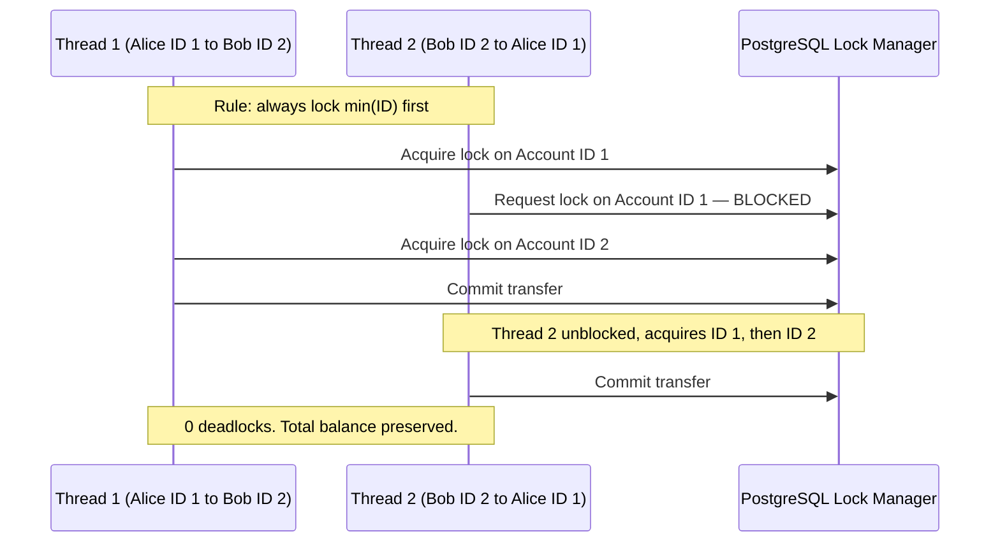
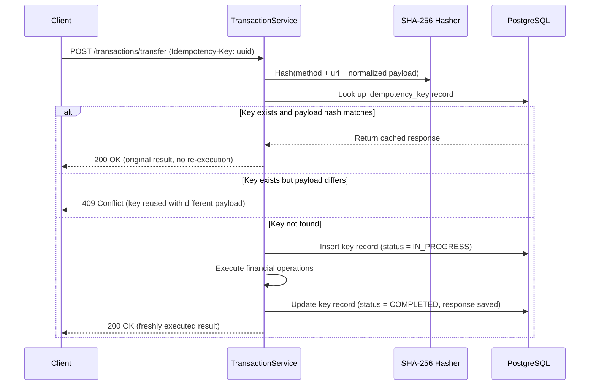

# System Architecture — Balance Vault

**Version:** 1.0.0

This document describes the layered architecture, financial integrity mechanisms, concurrency strategy, idempotency engine, and security design of the Balance Vault platform.

---

## System Overview

Balance Vault is a full-stack financial transaction platform built on a strict double-entry accounting model. The backend enforces balance integrity through multiple independent mechanisms — application-layer validation, database-level constraints, pessimistic row locking, and immutable ledger records — so that financial data remains accurate even under concurrent access and hardware failures.



---

## Layered Package Design

The backend follows a strict layered architecture where each package has a single defined responsibility:

| Package      | Responsibility                                                           | Key Constraints                                             |
|--------------|--------------------------------------------------------------------------|-------------------------------------------------------------|
| `config`     | Spring Security, CORS, Web MVC, password encoder, ObjectMapper.          | No business logic.                                          |
| `controller` | Thin REST controllers that accept DTOs and delegate to services.          | No entity exposure. No direct database interaction.         |
| `dto`        | Request and response objects with Bean Validation annotations.            | No database annotations or domain logic.                    |
| `entity`     | JPA entities mapped to PostgreSQL tables.                                | All financial fields use `BigDecimal`. Constraints declared. |
| `enums`      | Strongly typed status and role representations.                           | Closed sets; no open strings for financial states.          |
| `exception`  | Centralized exception hierarchy, `@RestControllerAdvice` error handler.   | RFC-7807 formatted error responses.                         |
| `repository` | Spring Data JPA with custom locking queries.                             | Hydration happens inside a transaction.                     |
| `security`   | JWT validation, token blacklist, IDOR ownership validators.               | Independent of financial business logic.                    |
| `service`    | Transactional business logic and financial orchestration.                 | Enforces idempotency, lock ordering, and balance mutations. |
| `ledger`     | `DoubleEntryLedgerEngine` — validates Σ(Debits) = Σ(Credits) = Amount.  | Throws `UnbalancedLedgerException` on mismatch.             |
| `audit`      | Append-only event logging for security and financial events.             | `@Immutable` entity; deletion permanently disabled.         |
| `util`       | BigDecimal helpers, SHA-256 hashing, reference number generation.        | Pure, deterministic, stateless functions.                   |

---

## Financial Integrity: Double-Entry Accounting

### The Balance Equation

Every financial movement in the system produces a persistent `Transaction` record accompanied by at least two balanced `LedgerEntry` records. The invariant is:

> Σ(Debits) = Σ(Credits) = Transaction Amount

If this equation does not hold, `DoubleEntryLedgerEngine` throws `UnbalancedLedgerException`, and the Spring `@Transactional` boundary rolls back the entire operation — including balance updates, ledger entries, and audit log inserts.



### System Clearing Accounts

Deposits and withdrawals represent money entering or leaving the platform from an external source. To preserve double-entry integrity without real payment gateway integration, the system maintains two institutional clearing accounts:

- **`SYS-CLEARING-DEP`:** Counterparty for all customer deposits. When a customer deposits funds, their account is debited and this clearing account is credited.
- **`SYS-CLEARING-WDL`:** Counterparty for all customer withdrawals. When a customer withdraws, their account is credited and this clearing account is debited.

### Exact Financial Arithmetic

All financial values use `BigDecimal` with scale 2 and `RoundingMode.HALF_EVEN` (Banker's Rounding). The use of `double` or `float` for monetary calculations is strictly prohibited. Amounts at or below $0.00 are rejected before any financial logic runs. Negative balances are enforced at two independent levels:

1. The `DoubleEntryLedgerEngine` validates sufficient balance before any state change.
2. PostgreSQL enforces `CHECK (balance >= 0)` at the database layer as a final safety net.

### Ledger Immutability

Historical ledger records cannot be modified or deleted once written:

- The `LedgerEntry` entity is annotated `@org.hibernate.annotations.Immutable` with all column mappings marked `updatable = false`.
- `LedgerEntryRepository` overrides all delete methods to throw `UnsupportedOperationException`.
- No REST endpoints exist for updating or removing ledger entries.
- If any step in a transaction fails, the Spring `@Transactional` boundary rolls back the entire unit, leaving no partial entries in the database.

---

## Concurrency and Deadlock Prevention

### Pessimistic Row Locking

When multiple concurrent requests attempt to debit the same account, a standard read-then-modify cycle allows overdrafts: two threads read the same balance, both pass the validation check, and both write updates that together exceed the actual balance.

Balance Vault prevents this using pessimistic write locks at the PostgreSQL level:

```java
@Lock(LockModeType.PESSIMISTIC_WRITE)
@Query("SELECT a FROM Account a WHERE a.id = :id")
Optional<Account> findByIdWithLock(@Param("id") Long id);
```

This translates to `SELECT ... FOR UPDATE`, which blocks other transactions from reading or modifying the locked row until the current transaction commits or rolls back.

### Deterministic Lock Ordering

Bidirectional transfers create a classic deadlock risk: Thread 1 (Alice → Bob) holds a lock on Alice and waits for Bob; Thread 2 (Bob → Alice) holds a lock on Bob and waits for Alice. Neither can proceed.

The solution is to acquire locks in a consistent, deterministic order across all transaction paths:

```java
Long minId = Math.min(sourceId, destId);
Long maxId = Math.max(sourceId, destId);

Account firstLocked  = accountRepository.findByIdWithLock(minId).orElseThrow(...);
Account secondLocked = accountRepository.findByIdWithLock(maxId).orElseThrow(...);
```

Because every thread always locks the lower ID first, circular waits cannot form:



### Hibernate Cache Protection

To ensure a pessimistic lock always reads the actual on-disk state rather than a Hibernate L1 cache entry from earlier in the session, account IDs are resolved through a lightweight scalar query before the entity is loaded:

```java
@Query("SELECT a.id FROM Account a WHERE a.accountNumber = :accountNumber")
Optional<Long> findIdByAccountNumber(@Param("accountNumber") String accountNumber);
```

The `Account` entity is then hydrated from the database for the first time strictly under the `PESSIMISTIC_WRITE` lock.

---

## Idempotency Engine

Network retries, connection timeouts, and accidental double-clicks can submit the same money movement request more than once. The idempotency engine ensures each logical operation executes exactly once.

All deposit, withdrawal, and transfer endpoints require an `Idempotency-Key` header containing a client-generated UUID.



The key guarantees are:

- **Uniqueness:** Enforced by a PostgreSQL unique index on `idempotency_key`.
- **Atomicity:** Key insertion and financial execution share the same `@Transactional` boundary.
- **Tamper detection:** A SHA-256 hash of the canonical request payload is stored alongside the key. A replay with any payload modification returns `409 Conflict`.

---

## Authentication and Authorization

### JWT Authentication

The backend uses stateless JWT tokens signed with HMAC-SHA256 (JJWT 0.12.6). Tokens embed the user ID, username, and role, and expire after a configurable duration.

**Token revocation:** Upon logout, the SHA-256 hash of the token is stored in the `token_blacklist` table with its natural expiration timestamp. `JwtAuthenticationFilter` checks every incoming request against this table before processing it. Blacklisted tokens return `401 Unauthorized`.

Passwords are hashed with BCrypt and are never returned in API responses or written to log files.

### Role-Based Access Control

Three roles are defined, each with distinct access boundaries:

| Role       | Access                                                                             |
|------------|------------------------------------------------------------------------------------|
| `ADMIN`    | User management, account oversight, platform statistics, system health.            |
| `CUSTOMER` | Self-service financial operations on accounts they own.                            |
| `AUDITOR`  | Read-only access to transaction history, ledger journals, and audit logs. Cannot move funds. |

### IDOR Defense

The backend never trusts account identifiers or user IDs supplied by the client for ownership verification. All financial operations pass through `AccountOwnershipValidator`:

```java
public void validateAccountWriteAccess(Account account) {
    if (securityContextHelper.isAuditor()) {
        throw new AccessDeniedException("Auditors are restricted to read-only access");
    }
    User currentUser = securityContextHelper.getCurrentUser();
    if (!currentUser.getId().equals(account.getUser().getId()) && !securityContextHelper.isAdmin()) {
        throw new AccessDeniedException("You do not have permission to execute operations on this account");
    }
}
```

Ownership is verified against the authenticated user identity derived exclusively from the security context — never from request parameters.

---

## Append-Only Audit Trail

All security events, authentication attempts, and financial operations are recorded in the `audit_logs` table. The audit trail is designed to be tamper-resistant:

1. **Entity immutability:** `AuditLog` is annotated `@org.hibernate.annotations.Immutable`. All column mappings specify `updatable = false`.
2. **Repository hardening:** `AuditLogRepository` overrides `delete`, `deleteAll`, and `deleteById` to throw `UnsupportedOperationException`.
3. **Transaction propagation:** Financial operation audits share the outer `@Transactional` boundary. Security and authentication failure audits use `Propagation.REQUIRES_NEW` so they commit even when the outer transaction rolls back.
4. **Access restriction:** Audit query endpoints are restricted to `AUDITOR` and `ADMIN` roles.
