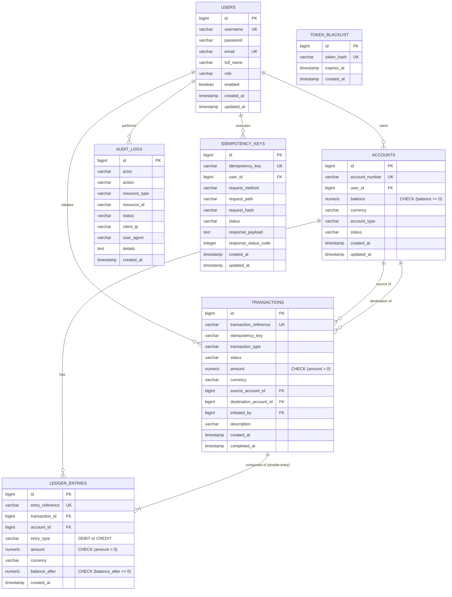

# LEDGERLINE – Database Design & Schema Specification

**Project:** LEDGERLINE – Money Movement With a Ledger You Can Prove  
**Assessment:** Snovasys 2026 Fresher Hiring Assessment  
**Database Engine:** PostgreSQL 16  
**Migration Framework:** Flyway (Version Controlled)  
**Version:** 1.0.0  

---

## 1. Entity-Relationship Diagram

---

## 2. Table Specifications

### 2.1 Table: `users`
Stores user identities, credentials, and authorization roles.

| Column | Type | Constraints | Description |
| :--- | :--- | :--- | :--- |
| `id` | `BIGSERIAL` | `PRIMARY KEY` | Auto-incrementing identifier |
| `username` | `VARCHAR(50)` | `NOT NULL, UNIQUE` | Unique login username |
| `password` | `VARCHAR(100)` | `NOT NULL` | BCrypt-hashed password (cost factor 10) |
| `email` | `VARCHAR(100)` | `NOT NULL, UNIQUE` | User email address |
| `full_name` | `VARCHAR(100)` | `NOT NULL` | User full display name |
| `role` | `VARCHAR(20)` | `NOT NULL` | Security role: `ADMIN`, `CUSTOMER`, `AUDITOR` |
| `enabled` | `BOOLEAN` | `NOT NULL DEFAULT TRUE` | Whether the user account is active |
| `created_at` | `TIMESTAMP WITH TIME ZONE` | `NOT NULL DEFAULT CURRENT_TIMESTAMP` | Creation audit timestamp |
| `updated_at` | `TIMESTAMP WITH TIME ZONE` | `NOT NULL DEFAULT CURRENT_TIMESTAMP` | Last updated timestamp |

---

### 2.2 Table: `accounts`
Holds customer savings/checking accounts and institutional system clearing counterparties.

| Column | Type | Constraints | Description |
| :--- | :--- | :--- | :--- |
| `id` | `BIGSERIAL` | `PRIMARY KEY` | Account identifier |
| `account_number` | `VARCHAR(30)` | `NOT NULL, UNIQUE` | Unique formatted number (e.g., `ACC-7392019482` or `SYS-CLEARING-DEP`) |
| `user_id` | `BIGINT` | `REFERENCES users(id)` | Owning user (`NULL` for system clearing accounts) |
| `balance` | `NUMERIC(19, 2)` | `NOT NULL DEFAULT 0.00, CHECK (balance >= 0)` | Current account balance |
| `currency` | `VARCHAR(3)` | `NOT NULL DEFAULT 'USD'` | ISO 4217 currency code |
| `account_type` | `VARCHAR(20)` | `NOT NULL` | `SAVINGS`, `CHECKING`, `SYSTEM_CLEARING` |
| `status` | `VARCHAR(20)` | `NOT NULL DEFAULT 'ACTIVE'` | `ACTIVE`, `FROZEN`, `CLOSED` |
| `created_at` | `TIMESTAMP WITH TIME ZONE` | `NOT NULL DEFAULT CURRENT_TIMESTAMP` | Account creation timestamp |
| `updated_at` | `TIMESTAMP WITH TIME ZONE` | `NOT NULL DEFAULT CURRENT_TIMESTAMP` | Account modification timestamp |

**Indexes:**
- `idx_accounts_user_id` on `accounts(user_id)`
- `idx_accounts_account_number` on `accounts(account_number)`

---

### 2.3 Table: `transactions`
Represents an individual financial transaction event.

| Column | Type | Constraints | Description |
| :--- | :--- | :--- | :--- |
| `id` | `BIGSERIAL` | `PRIMARY KEY` | Transaction identifier |
| `transaction_reference` | `VARCHAR(64)` | `NOT NULL, UNIQUE` | Unique reference (e.g., `TX-20261107-A9F4312B`) |
| `idempotency_key` | `VARCHAR(64)` | `NOT NULL` | UUID supplied by client |
| `transaction_type` | `VARCHAR(20)` | `NOT NULL` | `DEPOSIT`, `WITHDRAWAL`, `TRANSFER` |
| `status` | `VARCHAR(20)` | `NOT NULL` | `COMPLETED`, `PENDING`, `FAILED` |
| `amount` | `NUMERIC(19, 2)` | `NOT NULL, CHECK (amount > 0)` | Transaction nominal value |
| `currency` | `VARCHAR(3)` | `NOT NULL DEFAULT 'USD'` | Currency |
| `source_account_id` | `BIGINT` | `REFERENCES accounts(id)` | Debited account |
| `destination_account_id` | `BIGINT` | `REFERENCES accounts(id)` | Credited account |
| `initiated_by` | `BIGINT` | `REFERENCES users(id)` | User who submitted the request |
| `description` | `VARCHAR(255)` | | Human-readable transfer note |
| `created_at` | `TIMESTAMP WITH TIME ZONE` | `NOT NULL DEFAULT CURRENT_TIMESTAMP` | Transaction initiation timestamp |
| `completed_at` | `TIMESTAMP WITH TIME ZONE` | | Timestamp of ledger finalization |

**Indexes:**
- `idx_transactions_ref` on `transactions(transaction_reference)`
- `idx_transactions_source` on `transactions(source_account_id)`
- `idx_transactions_dest` on `transactions(destination_account_id)`
- `idx_transactions_user` on `transactions(initiated_by)`
- `idx_transactions_created` on `transactions(created_at DESC)`

---

### 2.4 Table: `ledger_entries`
The balanced double-entry journal records. Every transaction produces $\ge 2$ entries where $\sum \text{Debits} \equiv \sum \text{Credits}$.

| Column | Type | Constraints | Description |
| :--- | :--- | :--- | :--- |
| `id` | `BIGSERIAL` | `PRIMARY KEY` | Ledger entry identifier |
| `entry_reference` | `VARCHAR(64)` | `NOT NULL, UNIQUE` | Unique entry reference (e.g., `ENT-20261107-B8C2417E`) |
| `transaction_id` | `BIGINT` | `NOT NULL, REFERENCES transactions(id)` | Associated financial transaction |
| `account_id` | `BIGINT` | `NOT NULL, REFERENCES accounts(id)` | Affected account |
| `entry_type` | `VARCHAR(10)` | `NOT NULL, CHECK (entry_type IN ('DEBIT', 'CREDIT'))` | Entry direction |
| `amount` | `NUMERIC(19, 2)` | `NOT NULL, CHECK (amount > 0)` | Entry nominal amount |
| `currency` | `VARCHAR(3)` | `NOT NULL DEFAULT 'USD'` | Currency |
| `balance_after` | `NUMERIC(19, 2)` | `NOT NULL, CHECK (balance_after >= 0)` | Snapshot of account balance immediately after entry |
| `created_at` | `TIMESTAMP WITH TIME ZONE` | `NOT NULL DEFAULT CURRENT_TIMESTAMP` | Immutable entry creation timestamp |

**Indexes:**
- `idx_ledger_entries_tx` on `ledger_entries(transaction_id)`
- `idx_ledger_entries_account` on `ledger_entries(account_id)`
- `idx_ledger_entries_created` on `ledger_entries(created_at DESC)`

---

### 2.5 Table: `idempotency_keys`
Guarantees exactly-once execution for financial operations.

| Column | Type | Constraints | Description |
| :--- | :--- | :--- | :--- |
| `id` | `BIGSERIAL` | `PRIMARY KEY` | Key record identifier |
| `idempotency_key` | `VARCHAR(64)` | `NOT NULL, UNIQUE` | Client-supplied idempotency key |
| `user_id` | `BIGINT` | `NOT NULL, REFERENCES users(id)` | Authenticated user making request |
| `request_method` | `VARCHAR(10)` | `NOT NULL` | HTTP Method (`POST`) |
| `request_path` | `VARCHAR(255)` | `NOT NULL` | Target URI (`/api/v1/transactions/transfer`) |
| `request_hash` | `VARCHAR(64)` | `NOT NULL` | SHA-256 hash of canonical normalized request payload |
| `status` | `VARCHAR(20)` | `NOT NULL` | `IN_PROGRESS`, `COMPLETED`, `FAILED` |
| `response_payload` | `TEXT` | | Serialized JSON response returned to client |
| `response_status_code`| `INTEGER` | | HTTP response status code (`200`, `201`) |
| `created_at` | `TIMESTAMP WITH TIME ZONE` | `NOT NULL DEFAULT CURRENT_TIMESTAMP` | Record creation timestamp |
| `updated_at` | `TIMESTAMP WITH TIME ZONE` | `NOT NULL DEFAULT CURRENT_TIMESTAMP` | Completion timestamp |

**Indexes:**
- `uk_idempotency_key` on `idempotency_keys(idempotency_key)`
- `idx_idempotency_user` on `idempotency_keys(user_id)`

---

### 2.6 Table: `token_blacklist`
Provides immediate JWT revocation upon user logout without maintaining server-side session state.

| Column | Type | Constraints | Description |
| :--- | :--- | :--- | :--- |
| `id` | `BIGSERIAL` | `PRIMARY KEY` | Blacklist identifier |
| `token_hash` | `VARCHAR(64)` | `NOT NULL, UNIQUE` | SHA-256 hash of revoked JWT |
| `expires_at` | `TIMESTAMP WITH TIME ZONE` | `NOT NULL` | Token natural expiration timestamp |
| `created_at` | `TIMESTAMP WITH TIME ZONE` | `NOT NULL DEFAULT CURRENT_TIMESTAMP` | Invalidation timestamp |

**Indexes:**
- `uk_token_blacklist_hash` on `token_blacklist(token_hash)`
- `idx_token_blacklist_expires` on `token_blacklist(expires_at)`

---

### 2.7 Table: `audit_logs`
Append-only immutable record of all security, authentication, and money movement actions.

| Column | Type | Constraints | Description |
| :--- | :--- | :--- | :--- |
| `id` | `BIGSERIAL` | `PRIMARY KEY` | Audit identifier |
| `actor` | `VARCHAR(100)` | `NOT NULL` | Username or system principal |
| `action` | `VARCHAR(50)` | `NOT NULL` | Event action (`LOGIN_SUCCESS`, `TRANSFER`, `UNAUTHORIZED_ACCESS`) |
| `resource_type` | `VARCHAR(50)` | | Type of resource (`ACCOUNT`, `TRANSACTION`, `USER`) |
| `resource_id` | `VARCHAR(100)` | | Identifier of affected resource |
| `status` | `VARCHAR(20)` | `NOT NULL` | Outcome (`SUCCESS`, `FAILURE`, `DENIED`) |
| `client_ip` | `VARCHAR(50)` | | Originating IP address |
| `user_agent` | `VARCHAR(255)` | | Originating HTTP User-Agent header |
| `details` | `TEXT` | | Contextual event metadata or failure reason |
| `created_at` | `TIMESTAMP WITH TIME ZONE` | `NOT NULL DEFAULT CURRENT_TIMESTAMP` | Event timestamp |

**Indexes:**
- `idx_audit_logs_actor` on `audit_logs(actor)`
- `idx_audit_logs_action` on `audit_logs(action)`
- `idx_audit_logs_created` on `audit_logs(created_at DESC)`

---

## 3. Flyway Migration Version History

The database schema is managed reproducibly through Flyway versioned scripts located in `src/main/resources/db/migration`:

| Version | Migration Script | Description |
| :--- | :--- | :--- |
| `V1` | `V1__init_foundation.sql` | Baseline foundation and health check validation table. |
| `V2` | `V2__auth_and_accounts_schema.sql` | `users`, `accounts`, `token_blacklist` tables, foreign keys, and seed user accounts (`admin`, `auditor`, `alice`, `bob`). |
| `V3` | `V3__transactions_and_ledger_schema.sql` | `transactions`, `ledger_entries`, system clearing accounts (`SYS-CLEARING-DEP`, `SYS-CLEARING-WDL`), balance check constraints. |
| `V4` | `V4__idempotency_schema.sql` | `idempotency_keys` table, payload hashing columns, and unique constraints. |
| `V5` | `V5__audit_trail_schema.sql` | `audit_logs` table, indexes, and initial audit trail configuration. |
