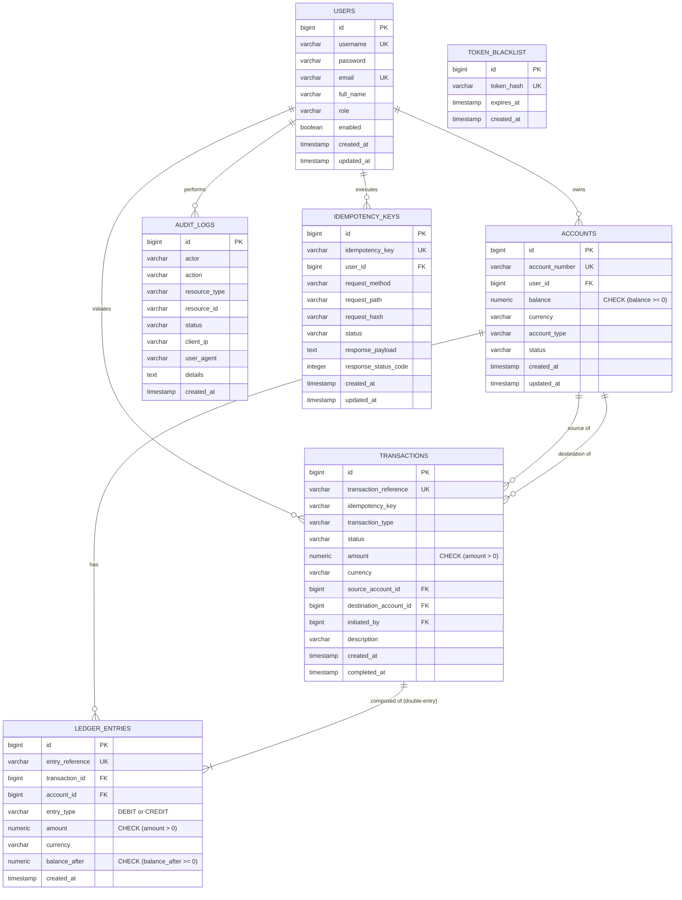

# Database Design and Schema Specification — Balance Vault

**Version:** 1.0.0  
**Database Engine:** PostgreSQL 16  
**Migration Framework:** Flyway 10.x  

---

## 1. Overview and Entity-Relationship Architecture

Balance Vault uses PostgreSQL 16 with Flyway version-controlled migrations. The schema is designed around strict foreign key relationships, database-level check constraints to guarantee non-negative balances, unique indexes for idempotency and transaction references, and an immutable append-only ledger and audit log structure.

---

## 2. Table Specifications

### 2.1 `users`
Maintains user authentication credentials, display identities, and system roles.

| Column | Type | Constraints | Description |
| :--- | :--- | :--- | :--- |
| `id` | `BIGSERIAL` | `PRIMARY KEY` | Unique internal user identifier. |
| `username` | `VARCHAR(50)` | `NOT NULL, UNIQUE` | Permanent user handle used for authentication. |
| `password` | `VARCHAR(100)` | `NOT NULL` | Salted BCrypt password hash. |
| `email` | `VARCHAR(100)` | `NOT NULL, UNIQUE` | Verified contact email address. |
| `full_name` | `VARCHAR(100)` | `NOT NULL` | Legal full name of the user. |
| `role` | `VARCHAR(20)` | `NOT NULL` | Security role: `ADMIN`, `CUSTOMER`, or `AUDITOR`. |
| `enabled` | `BOOLEAN` | `NOT NULL DEFAULT TRUE` | Status toggle; disabled accounts cannot authenticate. |
| `created_at` | `TIMESTAMP WITH TIME ZONE` | `NOT NULL DEFAULT CURRENT_TIMESTAMP` | Account creation timestamp. |
| `updated_at` | `TIMESTAMP WITH TIME ZONE` | `NOT NULL DEFAULT CURRENT_TIMESTAMP` | Last profile update timestamp. |

---

### 2.2 `accounts`
Stores individual customer accounts (savings, checking) as well as platform clearing accounts.

| Column | Type | Constraints | Description |
| :--- | :--- | :--- | :--- |
| `id` | `BIGSERIAL` | `PRIMARY KEY` | Internal account identifier. |
| `account_number` | `VARCHAR(30)` | `NOT NULL, UNIQUE` | Public account number (e.g. `ACC-ALICE-01`, `SYS-CLEARING-DEP`). |
| `user_id` | `BIGINT` | `REFERENCES users(id)` | Owning user (`NULL` for institutional clearing accounts). |
| `balance` | `NUMERIC(19, 2)` | `NOT NULL DEFAULT 0.00, CHECK (balance >= 0)` | Current account balance; negative values prohibited. |
| `currency` | `VARCHAR(3)` | `NOT NULL DEFAULT 'USD'` | Three-letter ISO 4217 currency identifier. |
| `account_type` | `VARCHAR(20)` | `NOT NULL` | Classification: `SAVINGS`, `CHECKING`, or `SYSTEM_CLEARING`. |
| `status` | `VARCHAR(20)` | `NOT NULL DEFAULT 'ACTIVE'` | Operational status: `ACTIVE`, `PENDING_APPROVAL`, `FROZEN`, `CLOSED`. |
| `created_at` | `TIMESTAMP WITH TIME ZONE` | `NOT NULL DEFAULT CURRENT_TIMESTAMP` | Creation timestamp. |
| `updated_at` | `TIMESTAMP WITH TIME ZONE` | `NOT NULL DEFAULT CURRENT_TIMESTAMP` | Last balance mutation timestamp. |

**Indexes:**
- `idx_accounts_user_id` on `accounts(user_id)`
- `idx_accounts_account_number` on `accounts(account_number)`

---

### 2.3 `transactions`
Records high-level financial transaction requests and execution status.

| Column | Type | Constraints | Description |
| :--- | :--- | :--- | :--- |
| `id` | `BIGSERIAL` | `PRIMARY KEY` | Internal transaction ID. |
| `transaction_reference` | `VARCHAR(64)` | `NOT NULL, UNIQUE` | Immutable transaction reference number. |
| `idempotency_key` | `VARCHAR(64)` | `NOT NULL` | Client-provided UUID to guarantee exactly-once processing. |
| `transaction_type` | `VARCHAR(20)` | `NOT NULL` | Action classification: `DEPOSIT`, `WITHDRAWAL`, or `TRANSFER`. |
| `status` | `VARCHAR(20)` | `NOT NULL` | Processing state: `COMPLETED`, `PENDING`, or `FAILED`. |
| `amount` | `NUMERIC(19, 2)` | `NOT NULL, CHECK (amount > 0)` | Transaction face value; non-positive values rejected. |
| `currency` | `VARCHAR(3)` | `NOT NULL DEFAULT 'USD'` | ISO 4217 currency code. |
| `source_account_id` | `BIGINT` | `REFERENCES accounts(id)` | Debited account (`NULL` for external deposits). |
| `destination_account_id` | `BIGINT` | `REFERENCES accounts(id)` | Credited account (`NULL` for external withdrawals). |
| `initiated_by` | `BIGINT` | `REFERENCES users(id)` | Authenticated user who submitted the request. |
| `description` | `VARCHAR(255)` | | Human-readable transfer purpose or memo. |
| `created_at` | `TIMESTAMP WITH TIME ZONE` | `NOT NULL DEFAULT CURRENT_TIMESTAMP` | Submission timestamp. |
| `completed_at` | `TIMESTAMP WITH TIME ZONE` | | Finalization and commitment timestamp. |

**Indexes:**
- `idx_transactions_ref` on `transactions(transaction_reference)`
- `idx_transactions_source` on `transactions(source_account_id)`
- `idx_transactions_dest` on `transactions(destination_account_id)`
- `idx_transactions_user` on `transactions(initiated_by)`
- `idx_transactions_created` on `transactions(created_at DESC)`

---

### 2.4 `ledger_entries`
The balanced double-entry accounting journal. Every transaction produces two or more entries where $\sum \text{Debits} \equiv \sum \text{Credits}$.

| Column | Type | Constraints | Description |
| :--- | :--- | :--- | :--- |
| `id` | `BIGSERIAL` | `PRIMARY KEY` | Ledger entry identifier. |
| `entry_reference` | `VARCHAR(64)` | `NOT NULL, UNIQUE` | Unique journal line reference code. |
| `transaction_id` | `BIGINT` | `NOT NULL, REFERENCES transactions(id)` | Associated transaction record. |
| `account_id` | `BIGINT` | `NOT NULL, REFERENCES accounts(id)` | Affected account. |
| `entry_type` | `VARCHAR(10)` | `NOT NULL, CHECK (entry_type IN ('DEBIT', 'CREDIT'))` | Entry direction. |
| `amount` | `NUMERIC(19, 2)` | `NOT NULL, CHECK (amount > 0)` | Entry monetary amount. |
| `currency` | `VARCHAR(3)` | `NOT NULL DEFAULT 'USD'` | ISO currency code. |
| `balance_after` | `NUMERIC(19, 2)` | `NOT NULL, CHECK (balance_after >= 0)` | Account balance immediately following this entry. |
| `created_at` | `TIMESTAMP WITH TIME ZONE` | `NOT NULL DEFAULT CURRENT_TIMESTAMP` | Ledger timestamp. |

**Immutability Guarantee:**
- Mapped as `@Immutable` in Hibernate with `updatable = false` across all columns.
- `LedgerEntryRepository` explicitly throws `UnsupportedOperationException` on any deletion request.
- No update or delete endpoints exist in the application layer.

**Indexes:**
- `idx_ledger_entries_tx` on `ledger_entries(transaction_id)`
- `idx_ledger_entries_account` on `ledger_entries(account_id)`
- `idx_ledger_entries_created` on `ledger_entries(created_at DESC)`

---

### 2.5 `idempotency_keys`
Guarantees safe request retry and eliminates double-charging or duplicate transfers.

| Column | Type | Constraints | Description |
| :--- | :--- | :--- | :--- |
| `id` | `BIGSERIAL` | `PRIMARY KEY` | Key record ID. |
| `idempotency_key` | `VARCHAR(64)` | `NOT NULL, UNIQUE` | Client-supplied unique token (UUID). |
| `user_id` | `BIGINT` | `NOT NULL, REFERENCES users(id)` | Authenticated user submitting the request. |
| `request_method` | `VARCHAR(10)` | `NOT NULL` | HTTP verb (`POST`). |
| `request_path` | `VARCHAR(255)` | `NOT NULL` | Endpoint URI (`/api/v1/transactions/transfer`). |
| `request_hash` | `VARCHAR(64)` | `NOT NULL` | Canonical SHA-256 fingerprint of the request payload. |
| `status` | `VARCHAR(20)` | `NOT NULL` | Lifecycle state: `IN_PROGRESS`, `COMPLETED`, `FAILED`. |
| `response_payload` | `TEXT` | | Cached JSON response returned on identical replay. |
| `response_status_code` | `INTEGER` | | HTTP status code returned on completion (`200`, `201`). |
| `created_at` | `TIMESTAMP WITH TIME ZONE` | `NOT NULL DEFAULT CURRENT_TIMESTAMP` | Initial receipt timestamp. |
| `updated_at` | `TIMESTAMP WITH TIME ZONE` | `NOT NULL DEFAULT CURRENT_TIMESTAMP` | Completion timestamp. |

**Indexes:**
- `uk_idempotency_key` on `idempotency_keys(idempotency_key)`
- `idx_idempotency_user` on `idempotency_keys(user_id)`

---

### 2.6 `token_blacklist`
Stores invalidated JWT signatures upon logout to enforce immediate token expiration without holding session state.

| Column | Type | Constraints | Description |
| :--- | :--- | :--- | :--- |
| `id` | `BIGSERIAL` | `PRIMARY KEY` | Identifier. |
| `token_hash` | `VARCHAR(64)` | `NOT NULL, UNIQUE` | SHA-256 digest of the invalidated JWT. |
| `expires_at` | `TIMESTAMP WITH TIME ZONE` | `NOT NULL` | Natural expiration timestamp of the token. |
| `created_at` | `TIMESTAMP WITH TIME ZONE` | `NOT NULL DEFAULT CURRENT_TIMESTAMP` | Invalidation timestamp. |

**Indexes:**
- `uk_token_blacklist_hash` on `token_blacklist(token_hash)`
- `idx_token_blacklist_expires` on `token_blacklist(expires_at)`

---

### 2.7 `audit_logs`
An append-only security and operational audit trail tracking all authorization, authentication, and ledger events.

| Column | Type | Constraints | Description |
| :--- | :--- | :--- | :--- |
| `id` | `BIGSERIAL` | `PRIMARY KEY` | Audit record identifier. |
| `actor` | `VARCHAR(100)` | `NOT NULL` | Initiating username or `ANONYMOUS`. |
| `action` | `VARCHAR(50)` | `NOT NULL` | Action code (e.g. `LOGIN_SUCCESS`, `TRANSFER`, `WITHDRAWAL_FAILED`). |
| `resource_type` | `VARCHAR(50)` | | Affected resource category (`ACCOUNT`, `TRANSACTION`, `USER`). |
| `resource_id` | `VARCHAR(100)` | | Target resource identifier. |
| `status` | `VARCHAR(20)` | `NOT NULL` | Operation result (`SUCCESS`, `FAILURE`, `REJECTED`). |
| `client_ip` | `VARCHAR(50)` | | Client IPv4 or IPv6 network address. |
| `user_agent` | `VARCHAR(255)` | | Request HTTP user-agent header. |
| `details` | `TEXT` | | Sanitized context or rejection reason (no credentials). |
| `created_at` | `TIMESTAMP WITH TIME ZONE` | `NOT NULL DEFAULT CURRENT_TIMESTAMP` | Exact logging timestamp. |

**Indexes:**
- `idx_audit_logs_actor` on `audit_logs(actor)`
- `idx_audit_logs_action` on `audit_logs(action)`
- `idx_audit_logs_created` on `audit_logs(created_at DESC)`

---

## 3. Flyway Migration History

All schema revisions are versioned and managed sequentially in `src/main/resources/db/migration`:

| Version | Script Name | Scope and Changes |
| :--- | :--- | :--- |
| `V1` | `V1__init_foundation.sql` | Baseline database foundation and system health probe verification table. |
| `V2` | `V2__auth_and_accounts_schema.sql` | `users`, `accounts`, `token_blacklist` tables, foreign keys, and seed accounts. |
| `V3` | `V3__transactions_and_ledger_schema.sql` | `transactions`, `ledger_entries`, system clearing accounts, and balance constraints. |
| `V4` | `V4__idempotency_schema.sql` | `idempotency_keys` table with SHA-256 fingerprint column and unique index. |
| `V5` | `V5__audit_trail_schema.sql` | `audit_logs` table, indexes, and immutable audit event configuration. |
